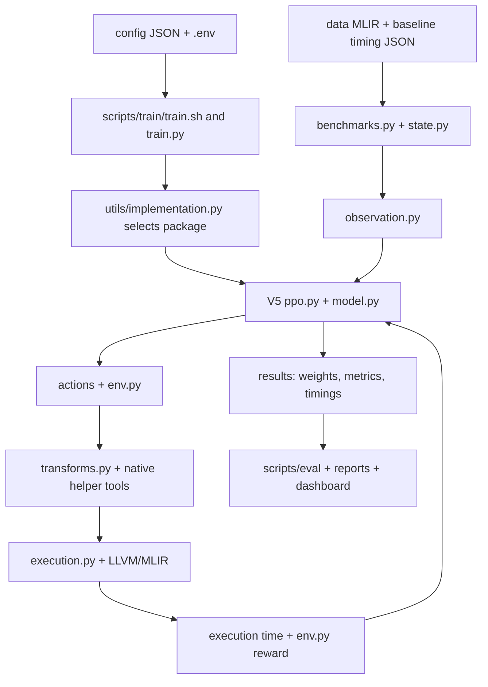

# MLIR-RL-V2: repository structure and autoscheduler code map

This standalone map describes the checkout at
`/scratch/ab13817/Code/MLIR-RL-V2`. All relative paths in this document start
there; prepend that root to obtain an absolute path. The map is based on
both the existing docs and the actual files/imports, checked on 2026-10-25.
Generated dataset/result layouts are distinguished from files present now.

## 1. Where is the autoscheduler?

The project's autoscheduler is Python code under:

**`/scratch/ab13817/Code/MLIR-RL-V2/rl_autoschedular/`**

The V5 implementation is:

**`/scratch/ab13817/Code/MLIR-RL-V2/rl_autoschedular/rl_autoschedular_v5/`**

It is a collection of cooperating modules, not a single executable or an
`agent.py` file. Start with these actual files:

| Question | V5 source file | What to look for |
| --- | --- | --- |
| Where is the neural policy? | `rl_autoschedular/rl_autoschedular_v5/model.py` | `HiearchyModel` (spelling in code), `PolicyModel`, `ValueModel`, `TransformerEmbedding`. |
| Where does learning happen? | `rl_autoschedular/rl_autoschedular_v5/ppo.py` | `collect_trajectory`, `ppo_update`, `value_update`, `evaluate_benchmarks`. |
| How does an action change state and earn reward? | `rl_autoschedular/rl_autoschedular_v5/env.py` | `Env.reset`, `Env.step`, `apply_and_run_sequence`, reward methods. |
| How is the program represented? | `rl_autoschedular/rl_autoschedular_v5/state.py` | Operation/benchmark features and state, external feature extraction. |
| How does the neural network see that state? | `rl_autoschedular/rl_autoschedular_v5/observation.py` | Observation tensors, operation features, history and action masks. |
| Which transformations can be chosen? | `rl_autoschedular/rl_autoschedular_v5/actions/` | Action classes and `ActionSpace` in `__init__.py`. |
| Where are compiler transformations applied? | `rl_autoschedular/rl_autoschedular_v5/transforms.py` | MLIR transform construction/application and helper invocation. |
| Where is code compiled and timed? | `rl_autoschedular/rl_autoschedular_v5/execution.py` | Compilation, execution, caching and failure handling. |
| Where are benchmarks loaded? | `rl_autoschedular/rl_autoschedular_v5/benchmarks.py` | `Benchmarks`, configured MLIR inputs and baseline timings. |
| Where are rollout data/returns kept? | `rl_autoschedular/rl_autoschedular_v5/trajectory.py` | Trajectory collection and training tensors. |
| Where is distributed collection? | `rl_autoschedular/rl_autoschedular_v5/distributed.py` | `rollout_group`, `collect_distributed_trajectory`. |
| How are raw full models adapted? | `rl_autoschedular/rl_autoschedular_v5/full_model.py` | Timed entry-point adaptation and elided-resource handling. |

The directory name **MLIR-RL-V2** identifies this repository checkout. It does
not mean every experiment uses the older **rl_autoschedular_v2** agent.
The selected configuration determines which agent package runs.

## 2. How the system fits together



A schedule is an ordered set of compiler transformations, such as tiling,
loop interchange and vectorization. The policy chooses it. The compiler
applies it. Execution time compared with a baseline supplies feedback.
Training updates network weights; evaluation loads saved weights to assess
schedules. The files under `llvm-project/` implement compiler infrastructure,
while this repository's Python agent decides which transformations to try.

## 3. Complete top-level map

```text
/scratch/ab13817/Code/MLIR-RL-V2/
├── .env                         Local toolchain paths (ignored)
├── .env.example                 Shareable settings template
├── .gitignore                   Rules excluding heavy/local output
├── .git/                        V2 Git metadata
├── AGENTS.md                    Repository instructions for coding assistants
├── README.md                    General project entry point
├── MLIR_Setup.md                Preserved historical setup instructions
├── MLIR_LLVM_SETUP_V2.md         Actual V2 installation paths and setup steps
├── REPOSITORY_STRUCTURE.md      This code and folder map
├── environment.yml              Historical Conda export
├── requirements.txt             Core training Python dependencies
├── experiments.json             Experiment registry
├── EXPERIMENT_STATUS.md         Recorded experiment status
├── quick_commands.txt           Command notes
├── config/                      Experiment JSONs
├── rl_autoschedular/            RL implementations and optimization actions
├── utils/                       Shared script/config/import/logging utilities
├── scripts/                     Training, evaluation and workflow entry points
├── tools/                       Project-specific C++ helper source + local builds
├── llvm-project/                Local LLVM/MLIR source + compiled toolchain
├── data_utils/                  Model conversion and benchmark generation
├── data/                        Local benchmark/model inputs (ignored)
├── results/                     Generated experiment artifacts (ignored)
├── logs/                        Slurm/stdout/debug logs (ignored)
├── dask-logs/                   Distributed-worker logs (ignored)
├── dashboard/                   Streamlit result viewer
├── plots/                       Figure/report assets
├── tests/                       Distributed V5 checks
└── docs/                        Concepts, workflows, design, research and history
```

## 4. Agent versions under rl_autoschedular/

Each version has its own source and can be selected by configuration.
Version packages are intended to remain isolated; edit the chosen package
rather than copying imports from another version.

| Directory | Role |
| --- | --- |
| `rl_autoschedular_v0/` | Original LSTM baseline. |
| `rl_autoschedular_v1/` | Hardware-aware observations. |
| `rl_autoschedular_v2/` | Intermediate shaped-reward variant. |
| `rl_autoschedular_v2_5/` | Hardened shaped-reward variant. |
| `rl_autoschedular_v3/` | Transformer-based encoder generation. |
| `rl_autoschedular_v4/` | Combined earlier enhancements. |
| `rl_autoschedular_v4_5/` | Robust integrated variant. |
| `rl_autoschedular_v4_9/` | Transformer variant with shaped reward disabled. |
| `rl_autoschedular_v45_no_hw/` | Hardware-feature ablation. |
| `rl_autoschedular_v45_no_shaped_reward/` | Reward-shaping ablation. |
| `rl_autoschedular_v45_no_transformer/` | Transformer ablation using an LSTM. |
| `rl_autoschedular_paper/` | Paper-reproduction LSTM implementation. |
| `rl_autoschedular_paper_transformer/` | Transformer comparison for the paper implementation. |
| `rl_autoschedular_v5/` | V5 CPU-benchmark platform, including distributed collection and full-model support. |
| `rl_autoschedular_v5_no_transformer/` | V5 LSTM comparison. |
| `actions/` | Additional top-level action source; V5 imports its own package's `actions/`. |

V4.6–V4.8 experiment labels do not necessarily imply matching Python package
directories. Inspect the config's `implementation` value rather than guessing
from the experiment name.

### V5 package layout

```text
rl_autoschedular/rl_autoschedular_v5/
├── __init__.py          Package/device setup
├── model.py             Policy, value network and Transformer encoder
├── ppo.py               Rollout collection and PPO/value updates
├── env.py               State transitions, rewards and schedule execution
├── state.py             Program and operation feature/state definitions
├── observation.py       Convert state into neural-network input
├── trajectory.py        Rollout storage, returns and training data
├── benchmarks.py        Benchmark loading
├── transforms.py        Apply compiler transformations
├── execution.py         Compile and measure transformed code
├── distributed.py       Distributed PPO trajectory collection
├── full_model.py        Adapt full-model input to the timed ABI
├── train.py             Package-level training entry point
├── evaluate.py          Package-level evaluation entry point
├── baseline.py          Package-level baseline utility
├── actions/             Choices and their parameters
│   ├── __init__.py       ActionSpace and exported classes
│   ├── base.py          Action interface
│   ├── interchange.py   Reorder loops
│   ├── tiling.py        Split loops into tiles
│   ├── tiled_parallelization.py  Parallel tiled execution
│   ├── tiled_fusion.py   Fuse producers/consumers using tiles
│   ├── vectorization.py Apply SIMD/vector operations
│   └── no_transformation.py      Leave an operation unchanged
└── utils/               Package-specific config, logging, isolation and Dask
```

`actions/` describes available choices; `transforms.py` implements compiler
changes; `env.py` coordinates state and reward. Changing an optimization can
therefore require understanding all three, plus observation/model dimensions.

## 5. Config selection and Python imports

The general training entry point is
`/scratch/ab13817/Code/MLIR-RL-V2/scripts/train/train.py`, normally launched
by `scripts/train/train.sh`. Evaluation uses `scripts/eval/eval.py` and
`eval.sh`. Package-level `train.py`/`evaluate.py` also exist; they are separate
entry points, not the filenames invoked by the standard wrappers.

`utils/implementation.py` resolves an `AUTOSCHEDULER_IMPL` environment override,
then configured implementation values, and imports the selected modules with
`import_autoschedular_module`. For example:

```json
{"implementation": "rl_autoschedular_v5"}
```

This selects the package in
`/scratch/ab13817/Code/MLIR-RL-V2/rl_autoschedular/rl_autoschedular_v5`.
The wrappers add `rl_autoschedular/` to `PYTHONPATH`, which is why source imports
use `from rl_autoschedular_v5...` without the outer directory in the name.

There are **two utility layers**:

- Root `utils/`: shared entry-point helpers such as implementation selection,
  config parsing, file logging, CSV helpers and execution dispatch.
- `rl_autoschedular/rl_autoschedular_v5/utils/`: V5's own Config, FileLogger,
  singleton, bindings-process and Dask implementation, used by V5 internals.

Do not assume a change to root `utils/config.py` changes the package-local
Config. Both read experiment settings through `CONFIG_FILE_PATH`; load the
environment and choose the config before importing code that instantiates it.

The root utility files are:

| File under `utils/` | Purpose |
| --- | --- |
| `config.py` | Shared entry-point configuration reader. |
| `implementation.py` | Package selection/imports and artifact naming/path helpers. |
| `file_logger.py` | Shared file-based experiment logging. |
| `dask_manager.py` | Shared execution-dispatch helper; distinct from V5's manager. |
| `bindings_process.py` | MLIR binding call/isolation helper. |
| `singleton.py` | Singleton support for configuration and managers. |
| `log.py` | Console/logging helpers. |
| `csvs.py` | CSV handling utilities. |
| `gpt2_jit_compat.py` | GPT-2 JIT compatibility support. |

V5 benchmarks target CPU execution, but its `__init__.py` selects CUDA for
PyTorch when available. CPU benchmark execution and the neural network's
PyTorch device are separate choices; inspect code and launch settings rather
than assuming every component is forced to CPU.

### config/ contents

| Directory | Contents |
| --- | --- |
| `config/ops_and_blocks/train/` | Training configurations for extracted ops/blocks. |
| `config/ops_and_blocks/eval/` | Matching separate evaluation configurations. |
| `config/mlir_rl_v1_paper/` | Paper-dataset configurations grouped under this dataset. |
| `config/v5/` | Unified train/eval configs: single-node, distributed, smoke, paper, full-model and LSTM variants. |

The important JSON fields are `implementation`, `benchmarks_folder_path`,
`results_dir`, `json_file`, `eval_json_file`, neural-network/training settings
and distributed settings. In the actual paper V5 config:

```text
config/v5/v5_mlir_rl_v1_paper.json
  implementation: rl_autoschedular_v5
  benchmarks_folder_path: data/mlir_rl_v1_paper
  results_dir: results/mlir_rl_v1_paper_results/v5_agent
  json_file: results/mlir_rl_v1_paper_results/baselines/mlir/base_train.json
  eval_json_file: results/mlir_rl_v1_paper_results/baselines/mlir/base_eval.json
  dask_node_count: 16
```

These are configured paths, not evidence the dataset/results exist locally.
For single-node work, inspect `config/v5/v5_single_node.json` or its smoke
variant. V5's local Dask manager can be enabled by `dask_node_count` or
`DASK_NODES`; older statements that Dask is always disabled do not describe
all current V5 modes. The actual import site and configuration decide behavior.

## 6. scripts/: workflow commands and launchers

| Directory/file | Contents and useful entry points |
| --- | --- |
| `scripts/train/` | `train.py` and `train.sh`, plus generated-data and older version-specific launchers. |
| `scripts/eval/` | `eval.py`, `eval.sh`, ablation evaluation, checkpoint submissions, queue orchestration, schedule replay and result merging. |
| `scripts/eval/eval_fullmodel.sh` | Full-model evaluation wrapper. |
| `scripts/eval/submit_fullmodel_matrix.sh` | Submit checkpoint/model combinations. |
| `scripts/eval/merge_fullmodel_matrix.py` | Merge those evaluations. |
| `scripts/eval/retired/` | Older evaluation orchestration. |
| `scripts/baseline/` | MLIR timing (`get_base.py`), PyTorch timing and full-model baseline scripts. |
| `scripts/data/` | Dataset generation wrappers, baseline JSON construction, `split_json.py`, comparison data. |
| `scripts/full_model/` | `preprocess_model.py`, `add_timing_wrapper.py` and result-merging/baseline wrappers. |
| `scripts/full_model/retired/` | Earlier full-model optimization drivers. |
| `scripts/checkpoint/retired/` | Earlier checkpoint scanning pipeline. |
| `scripts/hpo/` | Hyperparameter search (`run_hpo.py`), analysis, trial configs and local study database. |
| `scripts/plots/` | Plot/report generation and benchmark-family metadata. |
| `scripts/setup/` | Environment export/recreation and torch-mlir installation/check scripts. |
| `scripts/utils/` | Reporting (`fast_report.py`, `report_training.py`, `report_eval.py`), monitoring, classification and workflow helpers. |
| Root shell/Slurm files in `scripts/` | Generation launchers and environment probes; inspect assumptions before reuse. |

Some scripts modify datasets or remove checkpoints. A file being called a
utility is not evidence it is read-only. This documentation task does not
execute those workflows or submit jobs.

## 7. data_utils/: create the input programs

```text
data_utils/
├── convert_model.py       High-level model-to-MLIR conversion
├── extract_from_model.py  High-level benchmark extraction
├── cli.py                 Lower-level command interface
├── model_catalog.py       Supported-model registry
├── requirements.txt       Additional conversion dependencies
├── convert/               vision2mlir.py, transformers2mlir.py, gnn2mlir.py
├── extract/               extract_ops.py, extract_blocks.py, batch_policy.py
├── generate/              mlir_generators.py, generate_synthetic.py, id_allocator.py
└── postprocess/           wrap_mlir.py, strip_mlir.py
```

The intended flow is:

```text
model / ONNX or synthetic definition
  → linalg MLIR
  → extracted single operations / multi-operation blocks
  → timed MLIR benchmarks
  → baseline timing JSONs
  → train/eval splits
  → RL training and evaluation
```

Model conversion is optional if benchmarks already exist. It brings additional
PyTorch/torch-mlir/model-family dependencies beyond the compiler Python API.
The timed benchmark ABI and operation tags connect generated files to state
extraction and execution. Full-model adaptation is a separate path handled
by V5's `full_model.py` and full-model evaluation tooling.

## 8. tools/ versus llvm-project/

`tools/` contains this project's C++ source, which **is tracked**:

| Tool | Source | Current executable |
| --- | --- | --- |
| AstDumper | `tools/ast_dumper/main.cpp` and `CMakeLists.txt` | `tools/ast_dumper/build/bin/AstDumper` |
| PreVec | `tools/pre_vec/main.cpp` and `CMakeLists.txt` | `tools/pre_vec/build/bin/PreVec` |
| Vectorizer | `tools/vectorizer/main.cpp` and `CMakeLists.txt` | `tools/vectorizer/build/bin/Vectorizer` |

Only the helper build folders are ignored. The tools are used by both dataset
processing and runtime optimization; they are not merely setup utilities.

`llvm-project/` is the copied upstream compiler tree and is entirely ignored
by V2's Git repository. Its major components are:

| Path under llvm-project/ | Purpose |
| --- | --- |
| `llvm/` | Core compiler libraries, passes, code generation and utilities. |
| `mlir/` | MLIR dialects, transformation infrastructure, tools, Python source and tests. |
| `clang/`, `clang-tools-extra/` | C/C++ frontend and companion developer tools. |
| `openmp/` | OpenMP runtime and compiler support. |
| `build/bin/` | Compiled commands, including `mlir-opt` and `mlir-cpu-runner`. |
| `build/lib/` | Compiled libraries and `cmake/llvm`, `cmake/mlir` package metadata. |
| `build/tools/mlir/python_packages/mlir_core/` | Built MLIR Python package and native extensions. |
| `cmake/`, `third-party/` | Build infrastructure and bundled dependencies. |
| `lld/`, `lldb/` | Linker and debugger source. |
| `compiler-rt/`, `libc/`, `libcxx/`, `libcxxabi/`, `libunwind/`, `libclc/`, `llvm-libgcc/`, `runtimes/` | Runtime and standard-library projects. |
| `flang/`, `bolt/`, `polly/` | Fortran frontend, binary optimization and polyhedral optimization projects. |
| `offload/`, `cross-project-tests/`, `pstl/`, `utils/` | Offload support, cross-project tests, parallel-library source and utilities. |

Source being present does not mean every LLVM subproject was built. The copied
configuration enables MLIR, Clang and OpenMP, targeting X86. Do not edit LLVM
source to change the RL policy. For rebuilding, use fresh paths described in
[MLIR_LLVM_SETUP_V2.md](MLIR_LLVM_SETUP_V2.md); copied caches contain old paths.

## 9. data, results and logs: local content versus expected layout

At inspection, `data/`, `results/`, `logs/` and `dask-logs/` contain only their
ignore files. The docs describe datasets from earlier experiments that are
not automatically present in this checkout. Common intended datasets include
`data/ops_and_blocks/`, `data/mlir_rl_v1_paper/` and `data/full_models/`.
They are local inputs, not source code or included GitHub assets.

V5's logger writes directly into the configured `results_dir`; it does not
require a `run_N/` level. For the example paper config, expected generated
output is approximately:

```text
results/mlir_rl_v1_paper_results/
├── baselines/mlir/
│   ├── base_train.json      Required baseline/split inputs
│   └── base_eval.json
└── v5_agent/                Configured results_dir
    ├── models/model_N.pt    Learned model weights
    ├── eval/                Checkpoint timing/evaluation output
    ├── logs/
    │   ├── exec_data.json   Execution cache
    │   └── ...              Training and evaluation metric streams
    ├── csvs/                Report-generated comparisons, when produced
    └── tags                 Experiment metadata file
```

Exact report files depend on the invoked script. Some older documentation
shows `run_N/` layouts from historical workflows. Baseline locations also
vary: explicit config fields take precedence; automatic resolution helpers
in root `utils/implementation.py` support older `exec_times/` conventions.

Root `logs/` stores scheduler/stdout/debug output. Agent `results/.../logs/`
stores experiment metrics/cache. `dask-logs/` stores worker logs. These three
locations answer different debugging questions.

`experiments.json` registers experiments and their config/results paths;
`EXPERIMENT_STATUS.md` records status in prose. Neither contains the trained
policy. The policy's learned parameters live in generated `.pt` checkpoints.

## 10. dashboard, plots and tests

- `dashboard/dashboard.py`: Streamlit entry point.
- `dashboard/pages/`: version comparison, ablation, multiple-hardware and
  full-model pages.
- `dashboard/utils/`: data loading and plotting support.
- `dashboard/data/`: dashboard data/cache assets.
- `dashboard/requirements.txt`: dashboard-specific dependencies.
- `plots/experimentation_plots/` and `plots/manuscript/`: figure assets;
  plotting programs are mostly under `scripts/plots/`.
- `tests/test_v5_parallel.py`: distributed V5 checks. This checkout does not
  supply broad test coverage of every agent/version; do not infer that it does.

## 11. docs/: where the explanations live

| Folder | What it contains |
| --- | --- |
| `docs/onboarding/` | Nine introductions: MLIR, setup, architecture, RL internals, versions, actions, contributions, data pipeline and monitoring. |
| `docs/pipeline/` | Training/evaluation workflows, manuals and command references. |
| `docs/design/` | Configuration, version and methodology design references. |
| `docs/design/done/` | Implemented design write-ups, including V5 acceleration and full-model support. |
| `docs/design/todo/` | Proposed/future work; existence of a document alone does not establish implementation status. |
| `docs/data/` | Extraction, datasets, benchmark failures and older full-model workflow. |
| `docs/hpc/` | HPC hardware/access and C2 cluster guides. |
| `docs/investigations/` | Failure analysis, entropy collapse, LLVM discussion and model parameter investigations. |
| `docs/results/` | Evaluation tracking and HTML result explanations. |
| `docs/paper/` | Paper-oriented evaluation/distributed-training analysis. |
| `docs/manuscripts/` | Paper drafts, LaTeX sources and writing notes. |
| `docs/archive/` | Historical debugging notes and older incident reports. |
| `docs/guides/` | Git workflow guide. |

The docs are valuable context but contain historical assumptions. For example,
`rl_autoschedular/README.md` shows generic `agent.py`/`environment.py` files that
are not V5's actual filenames. V5's own README still describes the paper agent.
`docs/data/FULL_MODEL.md` describes an older V4.5 pipeline, and some design
filenames still sit under `todo/` although related code now exists. Root and
package-local utilities differ, and Dask behavior is configuration-dependent.
Use this map for locations and confirm behavior in the selected code/config.

## 12. Suggested reading and editing routes

| Goal | Read in this order |
| --- | --- |
| Understand MLIR | `docs/onboarding/01_WHAT_IS_MLIR.md`, then V2's setup guide. |
| Understand the autoscheduler | V5 `benchmarks.py` → `state.py` → `observation.py` → `model.py` → `env.py` → `ppo.py`. |
| Change an optimization | V5 `actions/` → `transforms.py` → `env.py`; inspect policy/mask dimensions too. |
| Change neural architecture | V5 `model.py` and `observation.py`, then the selected config. |
| Change reward | V5 `env.py`, then PPO/trajectory handling. |
| Debug compilation or timing | V5 `transforms.py`, `execution.py`, helper source and `.env`. |
| Add benchmarks | `data_utils/`, baseline scripts, split scripts and config dataset paths. |
| Understand distributed training | `scripts/train/train.py`, V5 `distributed.py` and `utils/dask_manager.py`. |
| Evaluate full models | `scripts/eval/eval_fullmodel.sh`, `scripts/eval/eval.py`, V5 `full_model.py`. |
| Find a saved policy | Inspect config `results_dir`, then its `models/model_N.pt`. |

For a working terminal setup and full rebuild commands with actual paths,
read [MLIR_LLVM_SETUP_V2.md](MLIR_LLVM_SETUP_V2.md).
