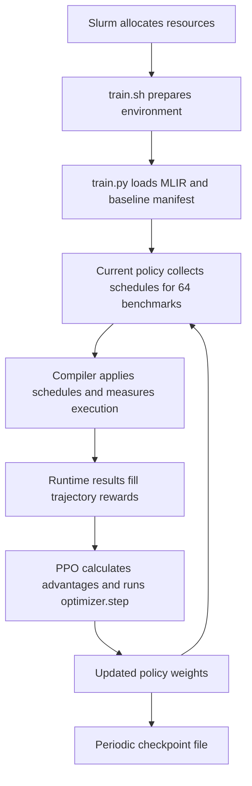

# V5 learning, starting from the downloaded data

This guide follows the code in this checkout from a Slurm submission to a PPO
weight update. It starts with existing MLIR files; dataset generation is outside
its scope. All paths are relative to `/scratch/ab13817/Code/MLIR-RL-V2`.

The central distinction is: **the dataset supplies programs to optimize; the
policy learns scheduling decisions by running those programs.** A checkpoint is
the saved policy, not an optimized copy of a dataset program.

Read sections 1–3 for installed files and prerequisites, sections 4–8 for the
actual learning loop, and sections 10–11 for checkpoint use and evaluation.



## 1. What was downloaded, and what is still needed

Dataset source: [Tay-eb/mlir-rl-dataset on Hugging Face](https://huggingface.co/datasets/Tay-eb/mlir-rl-dataset).
The downloaded revision is `917ed14cbb3a07bd01d58b058e8d7aaab84f9d95`.

| Local location | Contents at that revision | Used for |
| --- | --- | --- |
| `data/ops_and_blocks/` | 8,093 MLIR files | The dataset selected by `config/v5/v5_single_node.json` |
| `data/mlir_rl_v1_paper/` | 1,357 MLIR files | Paper-config workloads, including three full-model files |
| `data/full_models/` | 18 MLIR files | Full-model workloads; this release does not include the ONNX sources described in some older docs |
| `data/README.md` | Dataset publisher's description | Source documentation |
| `data/_download_manifest.json` | File sizes, source Git/LFS hashes, revision and verification status | Download provenance |

There are **9,470 publisher files, totaling 14,087,924,004 bytes**, including the
dataset README and `.gitattributes`. Additional local verification/provenance
files are not part of that publisher count.

Checkpoint source: [the supplied Google Drive folder](https://drive.google.com/drive/folders/135cMODJbRboFkDwFTpQH8M3XiNUChpW_).

| Downloaded name | Installed location | Compatibility |
| --- | --- | --- |
| `v5_model_1200.pt` | `checkpoints/v5_model_1200.pt` | Strict model-weight loading passes with `config/v5/v5_mlir_rl_v1_paper.json` |
| `v5_3_set1_base_p_model_3450.pt` | `checkpoints/v5_3_set1_base_p_model_3450.pt` | Its seven-action architecture is not implemented by the six-action V5 code in this checkout |

Checkpoint URLs, byte counts and SHA-256 hashes are recorded in
`results/pretrained/manifest.json`. This is an optional download receipt created
during installation. Normal training and evaluation do not read it. The
`checkpoints/` folder itself contains only the two downloaded weights files,
under their original names.

**The first checkpoint does not match the active `v5_single_node.json`.** Its
operation-feature input has 3,491 entries, matching the paper config's limits of
12. The single-node config uses limits of 7 and 711 operation-feature entries.
The paper config matches the weights' architecture; neither downloaded
checkpoint embeds its original training config or benchmark split, so this does
not prove which dataset/split originally trained it.

The V5.3 file also has an extra parameter head and a wider history-dependent
backbone input. Renaming it, removing its extra tensors, or changing only the
action count would not supply the missing action semantics. Its original
implementation/config are required to use it faithfully. See the local
[V5.3 design document](../docs/design/todo/v5_3_expanded_action_space.md).

**The Hugging Face release contains no JSON files.** Downloading it therefore
does not supply baseline measurements or train/eval membership. Whole-dataset
baseline timing and creation of a fresh split are separate preparation steps,
shown below. The original checkpoints' exact split cannot be reconstructed from
their weights.

## 2. The JSON files and what each one means

For the active single-node configuration:

| File | Producer | Consumer | Meaning |
| --- | --- | --- | --- |
| `config/v5/v5_single_node.json` | Experiment configuration already in the repo | Slurm wrapper, Config classes and agent | Paths, network dimensions and learning settings |
| `results/ops_and_blocks_results/baselines/mlir/base.json` | A baseline measurement run | Split preparation | Every measured benchmark and its unscheduled runtime; failed measurements can be `-1` |
| `results/ops_and_blocks_results/baselines/mlir/base_train.json` | Split preparation | `Benchmarks(is_training=True)` | Training membership **and** baseline runtime for each member |
| `results/ops_and_blocks_results/baselines/mlir/base_eval.json` | Split preparation | `Benchmarks(is_training=False)` | Evaluation membership **and** baseline runtime for each member |
| `results/ops_and_blocks_results/v5_single_node_agent/logs/exec_data.json` | Training/evaluation execution cache | `Execution.execute_code` | Runtime of a previously tried schedule on a benchmark |

The first row is an experiment config. The next three are baseline/membership
files. The last is a schedule cache. They cannot substitute for one another.

For the paper configuration, the analogous baseline paths are:

```text
results/mlir_rl_v1_paper_results/baselines/mlir/base.json
results/mlir_rl_v1_paper_results/baselines/mlir/base_train.json
results/mlir_rl_v1_paper_results/baselines/mlir/base_eval.json
```

`base.json` is useful for preparing the split, but the normal training loop
directly opens `base_train.json`. Evaluation directly opens `base_eval.json`.
Neither loop calculates missing baseline files automatically.

Here is the manifest format, using the actual one-benchmark installation
measurement stored in `results/installation_checks/baseline.json`. This entry
has not been installed as a whole-dataset training split:

```json
{
  "matmul_128_128_128": 3419826.0
}
```

With `benchmarks_folder_path="data/ops_and_blocks"`, it means:

```text
Load data/ops_and_blocks/matmul_128_128_128.mlir.
Remember 3,419,826 ns as its reference runtime.
Allow this benchmark to be sampled during training.
```

The keys select files; values provide the reference against which schedules are
judged. They are not optimal-action labels. A file absent from `base_train.json`
is not sampled for training, even if it exists in the dataset directory.

Source: [benchmarks.py, `Benchmarks.__init__`](../rl_autoschedular/rl_autoschedular_v5/benchmarks.py).

## 3. Measure the baseline before training

The baseline answers: **how long does this program take through the V5 compiler
pipeline without an agent-selected schedule?** It still uses compiler lowering
and LLVM optimization; "baseline" does not mean an interpreter or compilation
with all optimizations disabled.

The V5-compatible driver is
[scripts/baseline/baseline_fullmodels.py](../scripts/baseline/baseline_fullmodels.py).
Despite its name, `--pattern '*.mlir'` also allows it to measure block/operation
datasets. It performs:

```text
read a .mlir file
    → adapt the timed entry ABI if necessary
    → parse an MLIR Module
    → Execution.execute_code(module, benchmark_name, [], None)
    → record the measured time, or -1 on failure
```

The empty `[]` is the important part: no policy-selected transformations.

The existing legacy `scripts/baseline/get_base.py` passes a string to the
execution API, whereas V5 expects a parsed `Module`. Its `get_base.sh` wrapper
also has older environment/path assumptions. Use the parsed-module driver above
for the commands in this guide.

### Measure all single-node-config workloads on an allocated compute node

Run from the repository root, with sufficient allocation time. These commands
are preparation instructions, not a claim that all 8,093 baselines have already
been measured:

```bash
cd /scratch/ab13817/Code/MLIR-RL-V2
conda activate mlir
set -a
source .env
set +a
export CONFIG_FILE_PATH=config/v5/v5_single_node.json
export AUTOSCHEDULER_IMPL=rl_autoschedular_v5
export PYTHONPATH="$LLVM_BUILD_PATH/tools/mlir/python_packages/mlir_core:$PWD:$PWD/rl_autoschedular${PYTHONPATH:+:$PYTHONPATH}"

# Use the same OpenMP setting for baseline, training execution and evaluation.
export OMP_NUM_THREADS=12
mkdir -p results/ops_and_blocks_results/baselines/mlir

python scripts/baseline/baseline_fullmodels.py \
  --models-dir data/ops_and_blocks \
  --pattern '*.mlir' \
  --output results/ops_and_blocks_results/baselines/mlir/base.json \
  --timeout 300

python scripts/data/split_json.py \
  --input results/ops_and_blocks_results/baselines/mlir/base.json \
  --eval-ratio 0.2 \
  --seed 42
```

The baseline driver is sequential across files and saves progress after each
file. Rerunning skips positive completed timings and retries failed entries.
Large benchmarks may require a longer timeout. Do not interpret entries rejected
by the timeout as measured speedups.

The split command creates `base_train.json` and `base_eval.json` next to
`base.json`. It excludes nonpositive timings, shuffles within model-family
groups, and assigns about 20% of each group to evaluation. Consequently, final
counts depend on successful measurements. Check the command's printed counts.

Use explicit `--input` and `--output` paths here: some older path helpers derive
an `exec_times/` layout that differs from the explicit paths in the V5 configs.

For a fresh paper-dataset experiment, substitute `data/mlir_rl_v1_paper` and the
paper baseline directory. The three `model_*` programs are full models and can
be far more expensive. A fresh 80/20 split of that folder is **not** the original
paper split or the downloaded checkpoint's known historical split. Do not label
it as such.

### What exactly is timed?

[execution.py](../rl_autoschedular/rl_autoschedular_v5/execution.py) runs the same
main execution machinery for baseline and scheduled programs:

1. Bufferize tensors and lower vector operations.
2. Lower linalg/SCF/OpenMP/arithmetic operations toward LLVM.
3. Create an MLIR `ExecutionEngine` at optimization level 3.
4. Allocate zero-filled NumPy arguments with the required shapes/dtypes.
5. Invoke the program's `@main` twice.
6. Take the median of its two returned timing values.

The downloaded `matmul_128_128_128.mlir`, for example, accepts three
`tensor<128x128xf64>` arguments and surrounds the matmul with `@nanoTime()`
calls. The final return value is the elapsed time in nanoseconds. Both calls
contribute to the median; this routine does not discard a separate warm-up.

Python inference, compiler-transform work and JIT compilation are outside the
returned timer delta. They still consume wall time. Allocation/computation
inside the MLIR timer region contributes to that delta.

Benchmark code executes in an isolated process. A command-line
`mlir-opt`/`mlir-cpu-runner` route is attempted if the primary route fails.
Timeouts include compilation and invocation, even though the reward's timing
value comes from the program's internal timer.

Baselines must match the execution machine, compiler and thread settings used
for comparison. The downloaded files alone cannot provide a machine-independent
baseline. The normal executor uses zero inputs and checks completion, not output
equality against an independent reference.

## 4. What Slurm starts

After baseline preparation and experiment registration, a new single-node run
uses the existing wrapper:

```bash
# Submit from the repository root. Register the experiment in experiments.json
# first; use a distinct results_dir for a distinct fresh experiment.
OMP_NUM_THREADS=12 DASK_NODES=0 sbatch \
  --cpus-per-task=64 --mem=16G \
  scripts/train/train.sh config/v5/v5_single_node.json
```

This is an example command, not a job submitted while installing these assets.
The wrapper currently defaults to 8 CPUs/8 GB for a distributed driver. The
explicit override above fits the single-node path's heavier local collection.
Slurm partition/constraint availability must match the allocation environment.

[scripts/train/train.sh](../scripts/train/train.sh) does the following:

1. Slurm allocates the node/CPUs/memory and sets job environment variables.
2. The wrapper locates the repository from `SLURM_SUBMIT_DIR`.
3. It loads `.env`, activates its `CONDA_ENV`, and sets library/Python paths.
4. It resolves the config argument and reads its `implementation` field.
5. It exports `CONFIG_FILE_PATH` and `AUTOSCHEDULER_IMPL`.
6. It runs `python scripts/train/train.py`.

Slurm provides resources. The shell wrapper prepares the process. **Neither
updates neural weights.** The Python PPO code does that later.

The V5 selection is:

```text
config["implementation"] = "rl_autoschedular_v5"
    → utils/implementation.py imports that package
    → rl_autoschedular/rl_autoschedular_v5/
```

Both [root Config](../utils/config.py) and
[V5 Config](../rl_autoschedular/rl_autoschedular_v5/utils/config.py) read
`CONFIG_FILE_PATH` on their first singleton initialization. Feature dimensions
are also calculated during imports. Set the environment before imports, and use
a new Python process when switching configurations.

## 5. Startup: turn the manifest into a benchmark collection

[scripts/train/train.py](../scripts/train/train.py) calls `Benchmarks()` before
entering its training loop. For each training-manifest entry, the loader:

1. Opens the corresponding MLIR file.
2. Calls `AST_DUMPER_BIN_PATH` to extract operation, loop, indexing and dependency
   information. Its native source is [tools/ast_dumper/main.cpp](../tools/ast_dumper/main.cpp).
3. Parses that information into `BenchmarkFeatures` and `OperationFeatures`.
4. Attaches the JSON's reference runtime as `root_exec_time`.
5. Retains the program and features in memory for repeated sampling.

The native extractor assigns tags to operations in its returned code, so the
policy can target a particular operation later. It skips zero-loop linalg ops.
Representation limits matter: unsupported loop counts/ranks can be rejected and
load/store counts can be truncated.

The loader can apply img2col to supported single-op convolution names beginning
with `conv_2d_`, unless `DISABLE_IMG2COL=1`. It also adapts full-model timing ABIs
in memory through [full_model.py](../rl_autoschedular/rl_autoschedular_v5/full_model.py).
The downloaded source files are retained.

The training driver initializes `HiearchyModel` (the spelling in the source),
creates Adam with the configured learning rate, and seeds the RNGs. A fresh run
starts with random weights. Merely putting a checkpoint in `models/` does not
make the fresh-training path load it.

## 6. One concrete program, followed through the learning loop

Consider the downloaded file:

```text
data/ops_and_blocks/matmul_128_128_128.mlir
```

Its computation is equivalent to:

```text
for i in 0..127:
    for j in 0..127:
        for k in 0..127:
            C[i,j] += A[i,k] * B[k,j]
```

This same program exists in both downloaded operation datasets. The installation
check loaded it from `data/mlir_rl_v1_paper/` and measured a baseline of
**3,419,826 ns** with one OpenMP thread. The trace below uses that real check,
not a whole-dataset performance claim. Its config is
`results/installation_checks/v5_smoke.json`.

### A. Initialize the environment state

[env.py, `Env.reset`](../rl_autoschedular/rl_autoschedular_v5/env.py) copies the
benchmark's features and selects the last operation in its operation list. For
this one-operation program, that is the matmul.

Its state says, among other things:

```text
Current operation: matmul
Loops: i, j, k; bounds 128, 128, 128
Iterator kinds: parallel, parallel, reduction
Loads: A[i,k], B[k,j]; output access: C[i,j]
Selected producer: absent for this standalone operation
Schedule history: empty
Operation finished: false
```

The full benchmark code and reference time live in `Env.benchmark_data`.
`OperationState` identifies the operation currently being scheduled and stores
its original/current features, selected producer and transformation history.
Definitions are in [state.py](../rl_autoschedular/rl_autoschedular_v5/state.py).

### B. Convert state to an observation

[observation.py, `Observation.from_state`](../rl_autoschedular/rl_autoschedular_v5/observation.py)
turns the rich state into a fixed-size numeric tensor:

```text
[operation features | producer features | action history | loop count | masks]
```

**State is the environment's scheduling situation; observation is the encoded
view passed to the network.** Names, full source text, baseline time and the full
program graph are not directly supplied as network features.

For this matmul, operation features encode the matmul category, loop bounds,
parallel/reduction kinds, indexing coefficients and supported arithmetic counts.
With `normalize_bounds="max"`, 128 becomes `128/4096 = 0.03125`.

The single-node config pads each operation feature block to 711 entries and
produces a total observation width of 2,689. The paper config pads it to 3,491
and produces a total width of 9,449. This explains why the downloaded V5 weights
need the paper-shaped config.

A subtle but deliberate code detail: `OpFeatures` reads
`original_operation_features`. After tiling, that main block still describes the
original operation. History, masks, current loop count and producer features
provide additional scheduling context. The observation is not a freshly
re-extracted transformed AST at every decision.

### C. Ask the current policy for a decision

[model.py, `HiearchyModel.sample`](../rl_autoschedular/rl_autoschedular_v5/model.py)
produces a distribution over transformations and their parameters. Training
samples from those distributions. Invalid choices receive masked logits.

The action classes are registered in
[actions/__init__.py](../rl_autoschedular/rl_autoschedular_v5/actions/__init__.py):

| Symbol | Decision | Parameters |
| --- | --- | --- |
| `I` | Reorder loops | Permutation |
| `T` | Tile loops | Tile size per loop |
| `TP` | Tile and parallelize | Tile size per loop |
| `TPF` | Tile and fuse a producer | Tile sizes; producer comes from state |
| `V` | Attempt vectorization and finish this operation | No learned size parameter |
| `NT` | Finish this operation without another transformation | None |

With seven tile-size candidates, each dimension can choose no tiling or
1, 2, 4, 8, 16, 32, 64, subject to its mask. In pointer interchange mode,
successive choices construct a permutation without repeating loop indices.

The stochastic collection check actually produced this completed schedule:

```text
I(0,1,2)       keep the loop order
T(8,0,8)       tile i and k; leave j untiled
T(0,0,1)       further tile the current k dimension to 1
NT()           finish without another transformation
```

The three pointer decisions that form `I(0,1,2)`, followed by the two tiling
decisions and `NT`, account for the check's **six trajectory transitions**.
This was a sampled training rollout. It is not the checkpoint's greedy
evaluation result or a claim that this is its best schedule.

### D. Update the scheduling state, without a weight update

`Env.step(state, action)` records the decision and updates expected features.
For example, tile sizes change the current inner-loop bounds used by masks.
It then builds another observation for the next decision.

At this point:

- State/history have changed.
- The policy's neural weights have **not** changed.
- The program has **not** been compiled and timed after each individual choice.

`V`, `NT`, a state-update failure, or the schedule limit can finish an operation.
The configured action order also restricts the sequence. Pointer interchange's
partial choices count as several transitions but one completed history action.

For a multi-operation block, `get_next_op_state` moves backward to the preceding
operation and preserves the benchmark's accumulated schedules. Fusion can update
producer features along the way. The episode finishes only after the benchmark's
operations have been handled.

### E. Apply the completed schedule and measure it

Once schedule selection finishes, `Env.apply_and_run_sequence` parses a fresh
copy of the benchmark code and applies the recorded transformations.
[transforms.py](../rl_autoschedular/rl_autoschedular_v5/transforms.py) constructs
and runs MLIR Transform dialect operations. Then `Execution.execute_code`
lowers/JITs/invokes the resulting program, unless a schedule timing is cached.

For a block, this measures the **whole scheduled benchmark**, not the sum of
isolated per-operation speedups.

### F. Calculate the reward

The sampled schedule executed successfully and took **381,744 ns** in this
installation check:

```text
speedup = baseline / scheduled = 3,419,826 / 381,744 = about 8.96
terminal reward = log10(speedup) = about 0.95223
```

Successful intermediate transitions normally receive zero. The measured result
fills the benchmark's final transition reward. A slower program produces a
negative log-speedup reward. Transformation failures receive `-5`; execution
failure produces a terminal `-20` penalty.

Reward methods: `Env.__action_reward` and `Env.__speedup_reward`. No heuristic
reward-shaping bonus is added by this V5 environment.

## 7. How trajectory collection combines these experiences

The single-node entry is
[`ppo.collect_trajectory`](../rl_autoschedular/rl_autoschedular_v5/ppo.py).
For the active config, each outer iteration:

1. Samples 64 benchmark indices from the training collection with `randperm`.
2. Creates an environment and a `TrajectoryCollector` per selected benchmark.
3. Batches observations for environments still making decisions.
4. Samples actions using the **same current policy weights**.
5. Records decisions while progressing through operations.
6. Dispatches the completed benchmark schedules for application/execution.
7. Replaces provisional zero rewards with the execution-derived reward lists.
8. Concatenates the per-benchmark collectors into one `TrajectoryData`.

Each recorded transition contains:

```text
(loop count, observation, chosen action, behavior log-probability,
 next observation, reward, done)
```

The behavior log-probability records how likely the action was when sampled.
PPO uses it to compare the policy before and during its update.

`state.terminal` means **this operation is finished**. `done=True` in the
trajectory means **this benchmark episode is finished**. The distinction allows
reward information to propagate through decisions for multiple operations.

The number 64 appears twice in the config with different meanings:

| Setting | Meaning |
| --- | --- |
| `bench_count=64` | Programs selected for experience collection |
| `ppo_batch_size=64` | Scheduling transitions per gradient minibatch |

A benchmark can contribute several transitions per operation and several
operations. The collected dataset is therefore usually much larger than 64 rows.
An outer iteration is not a full pass over every benchmark file.

Trajectory storage and concatenation are in
[trajectory.py, `TrajectoryCollector` and `TrajectoryData`](../rl_autoschedular/rl_autoschedular_v5/trajectory.py).
With `reuse_experience="none"`, those newly collected transitions are used for
this update, rather than kept as a long-lived replay dataset.

The execution cache is different:

```text
logs/exec_data.json:
    benchmark name → schedule string → measured time
```

It can avoid repeating expensive lowering/JIT/timing for an identical schedule.
It does not contain the observation/action trajectory needed by PPO. Cache keys
do not include a compiler/hardware fingerprint, so cached measurements retain
the assumptions of the setup that produced them.

## 8. Exactly when the model updates

For `value_epochs=0` and `reuse_experience="none"`, the shared training driver's
normal iteration is equivalent to:

```python
trajectory = collect_trajectory(training_benchmarks, model, step)
ppo_update(trajectory, model, optimizer)
if step % 50 == 0:
    save_checkpoint(model, optimizer, step)
```

**Collection first; weight updates second.** The policy is not updated after
every action or every individual benchmark completion.

Inside `ppo_update`, `trajectory.update_attributes(model)` computes the value
predictions, returns and advantages before the gradient minibatch loops.

### The two neural networks

`HiearchyModel` contains:

- **Policy/actor:** predicts distributions over transformations and parameters.
- **Value/critic:** predicts expected future reward from an observation.

Each has its own Transformer feature encoder. Tokens describe the current
operation's loops, the selected producer's loops, and summaries; they are not
source-code word tokens. The default small encoder uses dimension 64, two heads,
two layers and CLS pooling. Its output is concatenated with action history.
Three 512-unit hidden layers feed the actor's output heads or critic's scalar.

### Return: what reward followed a decision?

In the ordinary on-policy configuration, returns accumulate future rewards
within each benchmark episode. The code uses discount `gamma=1.0`. With a single
terminal speed reward and otherwise zero rewards, earlier decisions can share
that eventual return.

### Advantage: was the result better than expected?

The critic's prediction is compared with what happened. GAE combines errors of
the form:

```text
delta = reward + next_value - current_value
advantage = delta + 0.95 * following_advantage
```

Episode-end masks stop propagation into the next benchmark. Positive advantage
encourages the sampled decision; negative advantage discourages it. Advantages
are standardized within minibatches in this configuration.

This is why a late runtime measurement can train an early loop-order decision:
the trajectory connects the sequence and the return/advantage calculation
carries the outcome backward.

### PPO: change preferences without changing them too far at once

For each minibatch, the model recomputes the probabilities of the recorded
actions. The ratio of new probability to collection-time probability is clipped
around 1 with a range of 0.2 in the current normal path.

The combined loss is:

```text
policy loss
    + 0.5 * value prediction loss
    - 0.01 * mean action entropy
```

The policy loss improves decision preferences, the value loss improves the
critic, and the entropy term encourages continued exploration.
`value_epochs=0` means **joint critic learning inside PPO**, not a disabled critic.

The configured four PPO epochs make four passes over the collected transition
dataset. On each minibatch, the code calls:

```python
optimizer.zero_grad()
loss.backward()
torch.nn.utils.clip_grad_norm_(model.parameters(), 0.5)
optimizer.step()
```

**`optimizer.step()` is the point where learning changes the weights.** Adam
updates the neural encoder, actor and critic. There is no gradient through the
MLIR compiler or through the wall-clock measurement.

Four PPO epochs are not four passes over all MLIR files. They are four uses of
the experience just collected for this outer iteration. `drop_last=True` in the
trajectory DataLoader means a final incomplete minibatch is omitted.

Relevant functions are `ppo_update`, `PolicyModel.loss`, `ValueModel.loss`,
`TrajectoryData.update_attributes`, `__compute_returns` and `__compute_gae`.

## 9. Single-node versus distributed learning

The active `v5_single_node.json` does not request Dask workers. Local execution
dispatch uses a `ThreadPoolExecutor` sized from `SLURM_CPUS_PER_TASK`; PyTorch's
driver thread count is set separately to four.

The paper config and `v5_distributed.json` currently specify 16 Dask workers.
`scripts/train/train.py` switches the collector to
[`distributed.collect_distributed_trajectory`](../rl_autoschedular/rl_autoschedular_v5/distributed.py).

```text
driver chooses 64 benchmarks and current weights
    → 16 groups of 4 benchmarks
    → workers make decisions and execute each group
    → driver gathers their transitions
    → driver performs one PPO update phase on the combined data
```

Workers hold replicas for collection; they do not train 16 unrelated agents.
The next iteration receives the driver's updated weights. Failed distributed
groups can be skipped, reducing that iteration's actual experience count.

Worker allocation and local fallback are implemented in
[V5 utils/dask_manager.py](../rl_autoschedular/rl_autoschedular_v5/utils/dask_manager.py).
`DASK_NODES` can override the configured count. Distributed workers currently set
`OMP_NUM_THREADS=12`; keep baseline comparisons consistent with this setting.

## 10. Saving, loading and resuming

The shared driver saves every 50 iterations and once at the end:

```text
<results_dir>/models/model_<step>.pt
```

The contents are:

```python
{"model": model.state_dict(), "optimizer": optimizer.state_dict(), "step": step}
```

The downloaded V5 checkpoint has exactly this structure and stored step 1200.
The V5.3 checkpoint stores step 3450. Neither contains its original config.
The model/optimizer tensors do not identify the original train/eval membership.

For a compatible experiment, `--resume <experiment-directory>` finds its largest
`model_N.pt`, loads model weights and attempts to load optimizer state. It then
continues with the filename's step plus one. It does not restore a saved RNG
state, and the weights alone do not preserve historical execution-cache data.

Downloaded weights are now stored together in `checkpoints/`. The existing
resume wrapper expects an experiment directory containing `models/model_N.pt`;
it does not load the central checkpoint folder automatically. If the chosen V5
weights are staged as `model_1200.pt` under the paper experiment's `models/`, the
matching-shaped resume command is:

```bash
sbatch scripts/train/train.sh config/v5/v5_mlir_rl_v1_paper.json \
  --resume results/mlir_rl_v1_paper_results/v5_agent
```

This requires suitable real baseline/split files first; using a fresh split
would continue training on that new split, not reproduce the unknown original
run. This paper config requests distributed workers. The command is documented,
not submitted by asset installation.

The package-local `rl_autoschedular_v5/train.py` is a separate older entry point
with a different checkpoint interval. The Slurm wrapper runs the shared
`scripts/train/train.py` described here.

## 11. Evaluation is separate from learning

The standard V5 loop does not evaluate the held-out set during training.
Evaluation follows:

```text
scripts/eval/eval.sh
    → scripts/eval/eval.py
    → Benchmarks(is_training=False)
    → load model weights
    → ppo.evaluate_benchmarks
    → greedy schedule selection
    → apply, compile and time
```

For a paper-config experiment containing `models/model_1200.pt`, once an
appropriate evaluation manifest exists, the standard command is below. The
downloaded `checkpoints/v5_model_1200.pt` would first need to be staged there;
the standard evaluator expects the experiment's checkpoint layout and filenames.

```bash
sbatch scripts/eval/eval.sh \
  config/v5/v5_mlir_rl_v1_paper.json --checkpoint 1200
```

Evaluation performs no `optimizer.step()`. Each benchmark speedup is
`baseline_time / scheduled_time`. The checkpoint-ranking CSV uses geometric mean
speedup across valid comparisons. Failed timings are `null` in the evaluation
JSON and excluded from that mean, so examine failure coverage as well.

Ordinary checkpoint result files store **times**:

```text
<results_dir>/eval/checkpoint_1200.json
    benchmark → optimized nanoseconds, or null
```

The separate `scripts/eval/final_eval.py` workflow repeats evaluator runs and
stores median **speedups** in `eval_final/checkpoint_N.json`. Those are different
units despite similar filenames.

Full-model evaluation uses the same local-operation policy within a complete
module and measures its complete timed region. Dedicated configs and
`scripts/eval/eval_fullmodel.sh` keep those results separate from block results.
The downloaded full models are under `data/full_models/`; the repository's
`data/full_models/relowered/` variant is not supplied by this dataset release.

## 12. Where to look while a run is learning

For the active single-node config:

```text
results/ops_and_blocks_results/v5_single_node_agent/
├── models/                     saved neural weights/optimizer
├── logs/
│   ├── exec_data.json           measured schedule-time cache
│   ├── train/
│   │   ├── reward              individual transition rewards
│   │   ├── final_speedup       per-benchmark collection result
│   │   └── entropy             exploration statistics
│   ├── train_ppo/
│   │   ├── policy_loss
│   │   ├── value_loss
│   │   ├── entropy_loss
│   │   ├── approx_kl
│   │   └── clip_frac
│   └── eval/                   evaluation logs and completion markers
├── eval/                       checkpoint-specific measured times
├── csvs/                       evaluation rankings and grouped results
└── tags
```

The metric files have no required extension and append values as text.
Slurm stdout/stderr is under `logs/train_<jobid>.out/.err` and
`logs/eval_<jobid>.out/.err`. The Python debug file also includes the job ID.

Collection time, PPO fit time and total iteration time describe training
throughput. Kernel speedup describes the generated program's performance. A
faster training iteration is not itself a better learned schedule.

## 13. Details of the current implementation to keep in mind

- `Config` reads explicit paths but does not implement the empty-path
  auto-derivation claimed in some older notes. The configs used above supply
  explicit paths.
- `ppo_clip_range`, `gae_lambda` and `max_grad_norm` are exposed in V5 Config,
  but this normal update path uses defaults/literals 0.2, 0.95 and 0.5. Changing
  those JSON fields alone does not change the corresponding calculations here.
- At an operation boundary, the collector advances to the next operation but
  stores the just-ended operation's observation as `next_obs`. For multi-op
  benchmarks, its value bootstrap therefore differs from the actual next
  decision's observation. The matmul example avoids that boundary case.
- The standard evaluator requests greedy actions and disables gradients but
  does not call `model.eval()`. Transformer dropout can still vary decisions.
- Execution failures currently return a fallback speedup of 1.0 in the
  environment's raw log path. Their timings remain `null` and the ranking code
  excludes them; do not equate raw mean-speedup logs with the ranking metric.
- Full-model elided resources are replaced with zeros by the loading adapter.
  Combined with zero input arrays and no reference-output comparison, this is
  performance measurement rather than validation of pretrained-model accuracy.

These describe the checked-in learning path, not modifications made while
downloading the assets.

## 14. Source map by question

| Question | File and main symbols |
| --- | --- |
| What does Slurm launch? | [scripts/train/train.sh](../scripts/train/train.sh) |
| What owns the outer training loop and checkpoint saves? | [scripts/train/train.py](../scripts/train/train.py) |
| Which agent package is imported? | [utils/implementation.py](../utils/implementation.py), `get_autoschedular_impl`, `import_autoschedular_module` |
| Which programs and baseline values enter training? | [V5 benchmarks.py](../rl_autoschedular/rl_autoschedular_v5/benchmarks.py), `Benchmarks` |
| How are state/features represented? | [V5 state.py](../rl_autoschedular/rl_autoschedular_v5/state.py), `BenchmarkFeatures`, `OperationFeatures`, `OperationState` |
| How does the network see the state? | [V5 observation.py](../rl_autoschedular/rl_autoschedular_v5/observation.py), `Observation.from_state` |
| What can it choose? | [V5 actions/](../rl_autoschedular/rl_autoschedular_v5/actions/), `ActionSpace` and individual classes |
| How does a decision affect the environment? | [V5 env.py](../rl_autoschedular/rl_autoschedular_v5/env.py), `step`, `get_next_op_state` |
| How is a reward obtained? | [V5 env.py](../rl_autoschedular/rl_autoschedular_v5/env.py), `apply_and_run_sequence`, reward methods |
| How are 64 benchmarks turned into experience? | [V5 ppo.py](../rl_autoschedular/rl_autoschedular_v5/ppo.py), `rollout_benchmarks`, `collect_trajectory` |
| Where do returns/advantages come from? | [V5 trajectory.py](../rl_autoschedular/rl_autoschedular_v5/trajectory.py), `TrajectoryData.update_attributes` |
| Where are weights changed? | [V5 ppo.py](../rl_autoschedular/rl_autoschedular_v5/ppo.py), `ppo_update`, `optimizer.step` |
| What architecture is trained? | [V5 model.py](../rl_autoschedular/rl_autoschedular_v5/model.py), `HiearchyModel`, `PolicyModel`, `ValueModel`, `TransformerEmbedding` |
| How do schedules become compiler transformations? | [V5 transforms.py](../rl_autoschedular/rl_autoschedular_v5/transforms.py) |
| How is native execution timed and cached? | [V5 execution.py](../rl_autoschedular/rl_autoschedular_v5/execution.py), `Execution` |
| How are unscheduled reference times produced? | [baseline_fullmodels.py](../scripts/baseline/baseline_fullmodels.py) |
| How are fresh membership manifests made? | [split_json.py](../scripts/data/split_json.py) |
| How does distributed collection differ? | [V5 distributed.py](../rl_autoschedular/rl_autoschedular_v5/distributed.py), `rollout_group`, `collect_distributed_trajectory` |
| Where do metrics go? | [root FileLogger](../utils/file_logger.py), [V5 FileLogger](../rl_autoschedular/rl_autoschedular_v5/utils/file_logger.py) |
| How are saved models evaluated? | [eval.sh](../scripts/eval/eval.sh), [eval.py](../scripts/eval/eval.py), `ppo.evaluate_benchmarks` |
| How is the best checkpoint selected? | [utils/csvs.py](../utils/csvs.py), `compute_geo_mean_speedup`, `rebuild_best_checkpoint` |

## 15. Installation verification

The asset installation records download verification in
`data/_download_manifest.json` and checkpoint provenance in
`results/pretrained/manifest.json`. The compatible V5 checkpoint was read with
PyTorch's restricted `weights_only=True` loader and strictly loaded into the
paper-shaped local V5 model. The V5.3 incompatibility was checked against actual
tensor keys/shapes, not inferred only from its filename.

Small execution/learning checks are kept under `results/installation_checks/`.
Their measurements are installation checks, not whole-dataset baselines and
not the downloaded checkpoint's original training/evaluation split. See that
directory's `verification.json` for the checks that actually completed.

These are optional records created while checking the download, rather than
files that a normal experiment must use:

| Record | Why it was created |
| --- | --- |
| `baseline.json` | The measured reference runtime for one downloaded matmul |
| `v5_smoke.json` | A copy of the paper config restricted to that one benchmark and one PPO epoch |
| `v5_smoke_agent/logs/` | Normal V5 logger output from that small check |
| `verification.json` | A summary of the checks and their results |

The baseline was generated with the existing
`scripts/baseline/baseline_fullmodels.py`. A temporary Python script then called
V5's `Benchmarks`, `Observation`, `collect_trajectory` and `ppo_update`, loaded
the downloaded V5 weights/optimizer, and wrote the summary. That temporary
script was removed during the requested `/tmp/` cleanup. Updates were performed
in memory; no updated checkpoint was saved over the downloaded weights.

Completed checks:

| Check | Observed result |
| --- | --- |
| Dataset integrity | All 9,470 publisher files match their recorded source sizes and Git/LFS hashes |
| V5 checkpoint | All model tensors strictly load; saved Adam optimizer state also loads |
| Real downloaded input | `data/mlir_rl_v1_paper/matmul_128_128_128.mlir` |
| Local baseline | 3,419,826 ns, stored in `results/installation_checks/baseline.json` |
| Observation encoding | Shape `[1, 9449]` with the paper-shaped config |
| Collection | Six transitions, zero benchmark execution failures |
| Sampled schedule | `I(0,1,2)T(8,0,8)T(0,0,1)NT()` |
| Scheduled execution | 381,744 ns, stored in the smoke agent's `logs/exec_data.json` |
| Rewards | `[0, 0, 0, 0, 0, 0.95223]` approximately |
| PPO update | One epoch with minibatch size 1; 110 model-state tensors changed and all updated tensors remained finite |
| Downloaded checkpoint preservation | Both SHA-256 hashes still match after the in-memory learning check |

The smoke check used one OpenMP/PyTorch thread and deliberately smaller
collection/update settings than production. Its standalone greedy forward check
called `model.eval()`; collection/PPO then used training mode. The standard
evaluation script's dropout behavior remains as described in section 13.

This check demonstrates the sequence:

```text
downloaded MLIR + locally measured reference
    → six observations/actions under the loaded policy
    → measured scheduled runtime
    → terminal reward 0.95223
    → returns/advantages
    → optimizer updates in-memory policy/value weights
```

No whole-dataset training or full-model evaluation job was submitted. The two
complete benchmark-split manifests still need to be measured/prepared or supplied
from the original experiment before a normal full training/evaluation launch.
